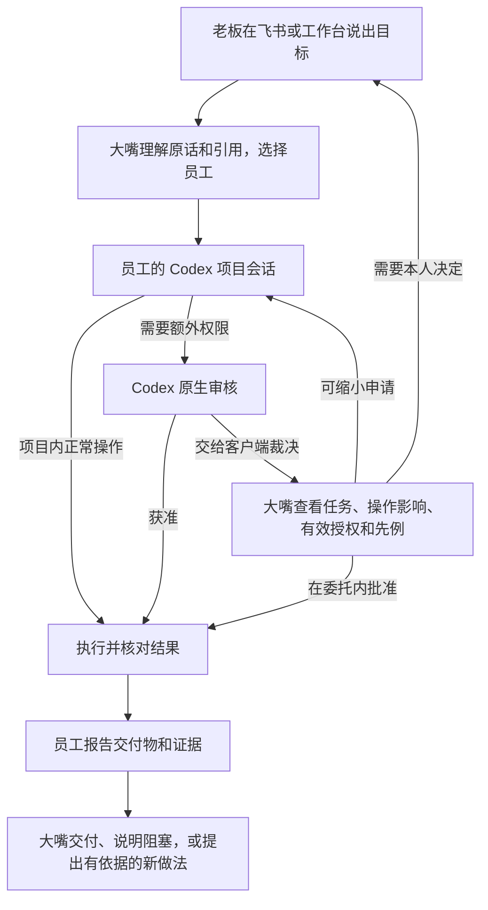

# 员工执行与审批

老板说出目标，大嘴决定交给谁。员工在自己的项目会话里选择工具、执行、检查结果。员工的本地 Codex 使用自己的登录、项目目录和会话历史。Dudu 负责把任务交进去，接回进度、原生审批和结果。

Codex 已作出的最终拒绝会作为结果返回。只有 Codex 发给客户端、仍在等待的请求才能代批。Windows 自己弹出的管理员确认框仍需本人处理。员工项目的原生终端和桌面 Codex 中另一个项目也可以使用不同的登录、软件设置和授权。

| 什么时候 | 谁作决定 | 判断依据 |
| --- | --- | --- |
| 老板说“再试试”“把第三部分放到一起” | 当前会话里的大嘴 | 老板原话、引用、选中的任务、在岗员工和已有结果。飞书按钮和明确的资源操作仍会核对身份及目标。 |
| 员工写代码、构建、运行程序、查看结果 | 员工和本机 Codex | 员工自己的模型、终端、目录和项目权限。可编辑的本地工作站在新建、恢复和开始执行时使用同一套原生审核。主动选择的只读或逐次询问模式仍按岗位配置生效。 |
| Codex 把一条申请交回客户端 | 大嘴，必要时由老板决定 | 大嘴能看到老板原指令、这一次的具体申请、影响范围和有效先例。决定写回正在等待的原生请求。若整条命令要求的权力过大，大嘴可以让员工在当前任务缩小申请一次。 |
| 员工调用飞书或其他外部应用 | 员工和对应服务 | 服务核对员工身份、当前任务、实际资源和这次调用。老板引用旧文档任务时可以沿用仍有授权的联系人。 |
| 员工受阻 | 大嘴的模型 | 读员工报告和上轮依据，决定交付、说明阻塞，或写明不同的做法与预期结果。两轮没有新增证据或产物相同，停止自动重派。老板的新指令可以恢复。 |

## 什么会记下来

- 员工继续自己的原生会话，保留该项目的工作过程。岗位长期记忆按现有开关维护。
- 大嘴派工时可以看到同一对话里少量相似任务，包含员工、主题和验证结果。私聊原文、命令参数和文件内容不会复制进这些派工先例。
- 大嘴代批前可以参考相同项目、员工和授权条件下的近期决定。运行时会重新核对权限、这次请求和有效期。老板撤销权限后，旧批准不能放行新操作。
- 老板新建任务、明确改派或给出新的条件时，以这次指令为准。过期的审批卡不能恢复已取消的任务。

## 本地代码从哪里查

| 入口 | 负责什么 |
| --- | --- |
| `backend/app/feishu/worker.py`、`backend/app/services/assignment_context.py` | 飞书原话、引用、员工选择、续办和同类派工经验 |
| `backend/app/services/codex_adapter.py` | 员工的 Codex 项目启动、恢复和原生请求 |
| `backend/app/services/employee_native_review.py`、`backend/app/team/steward_review.py` | 大嘴能够审哪一次真实请求，怎样把决定送回当前执行 |
| `backend/app/services/project_mcp_approvals.py`、`backend/app/team/feishu_assignment.py` | 员工对外部工具的授权和本次调用的凭据 |
| `backend/app/team/jobs.py`、`backend/app/team/progress_review.py` | 派工归属、结果证据、停止和续办 |
| `backend/app/services/memory_capture.py`、`backend/app/services/memory_recall.py` | 各员工经验的提取和检索 |

## 此次审查范围

以 Git `184d380` 为基准扫描全部 1,620 个受版本控制的文件，其中 1,513 个为代码或构建配置。880 个 Python 模块均做了语法树分析。人工核对集中在上表的执行路径，包括重启续办、授权撤回、旧任务引用和重复上报。工作台、桌面、手机、部署脚本及上游组件也计入扫描范围。
