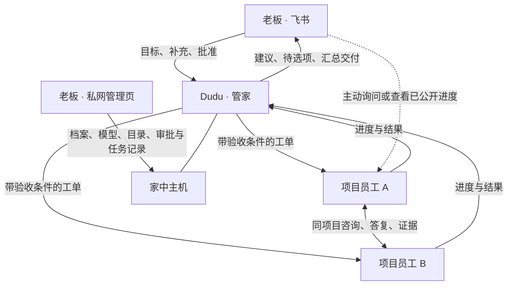

# Dudu OPC 需求核对

老板日常在飞书找管家 Dudu。Dudu 接单、派工、跟进和汇总。员工在项目内向同事请教，把结果交给 Dudu。家中主机保存角色资料、任务记录和项目文件，远端设备通过飞书或私网管理页使用同一套后台。

## 逐项核对

| 需求 | 原先已有 | 本版处理 | 仍需现场验证或配置 |
| --- | --- | --- | --- |
| 底座与执行位置 | 原生 Suparagent 的团队、任务、审批、引擎和会话 | 保留上游 Git 历史和许可证，直接扩展原生代码。Windows 本机保存文件、执行工具，Codex 模型经网络推理 | 引擎能力各自不同，未单独接入 DSH |
| 老板、管家与员工 | 已有团队负责人和任务板 | Dudu 派工和收结果。员工在同一项目内咨询同事，受询员工只读选定任务背景；咨询全程留痕。老板主动向员工提问时，员工可在原私聊或授权群话题回答 | 群里只能查看已公开的进度、答复和交付。员工内部咨询原文保存在本机 |
| 主动发现与决策 | 已有任务状态和审批 | Dudu 每两分钟看一次阻塞、逾期、待验收等工作，列出具体选项。老板可要简报、让 Dudu 跟进、稍后处理或跳过。建议可去重，状态变化会使旧建议失效，批准后才生成跟进任务 | 发现依据来自已有任务记录；主动发现和批准跟进都不会自行修改项目文件 |
| 两种协作方式 | 已有团队消息、房间和执行记录 | 派工、确认、咨询和汇报都保留文字。工单另存项目、负责人、目标、优先级、依赖、验收条件、交付物和事件。员工可分享标明来源的证据，Dudu 保留派工权限；同事的意见不构成老板批准 | 后台开放任务协议和执行记录给老板，飞书展示批准公开的部分 |
| 角色与任务上下文 | 已有角色目录、模型和任务范围 | 管家、员工各有自己的 `AGENTS.md` 和默认模型。资料可直接放入角色目录。先按角色、项目和功能寻找既有任务；明确续接沿用原会话，候选不清楚时确认。每次执行有独立记录，重复投递同一条消息只受理一次 | 不清楚时可直接回复任务编号。专业任务可用的文件和工具有明确范围 |
| 在飞书与 Codex 之间续接 | 可保存原生会话 ID | 后台给出工作目录和 `codex resume` 命令。用安装好的 Codex 检查过同一会话的占用、退出、续接和新增轮数。新用户气泡只放用户原话，工具和技能说明由后台传入 | 飞书不复制桌面聊天全文。已写入的旧聊天记录仍保留原貌 |
| 建员卡与后台 | 原有建员提案、模型发现、工作目录和聊天设置 | 首页可管员工、项目和待批事项。管家与员工都能改名字、头像、简介、模型、目录和工作指令。建员卡使用模型选择器，目录既可选择也可直接粘贴家中电脑的绝对路径。有单独的聊天、任务和设置入口 | 网页头像和飞书应用头像分别保存。飞书可提出用人需求，详细配置在后台完成 |
| 一次打开与日常聊天 | 原有本地启动脚本、飞书网关、消息队列 | 双击 `start-steward.cmd` 可启动并打开。草稿按聊天区分，已发草稿不跨对话恢复。飞书显示处理中，最终消息成功发送后撤回对应提示；重试不会撤回其他任务的提示 | 部署前已经写入的历史消息不会改写。关机期间未送达本机的飞书事件能否补收，需在租户实测 |
| 员工身份与群 | Dudu 已有独立飞书应用 | 每人可绑定各自的飞书应用、老板身份和授权工作群。后台派工和状态可发到员工话题，老板也可在已绑定话题内 @ 员工 | 每个员工需要在飞书开放平台有真实应用，配置并加入群后才能显示相应姓名和头像。[飞书接入步骤](FEISHU.md) |
| 技能、MCP、工具和速度 | 复用 Codex、团队桥接和技能服务 | 验证原生 Codex 读取会话和工具服务就绪；覆盖团队工具调用、权限及技能使用记录。单独记录启动、受理、首次输出和结束。Windows 可让独立 Codex 进程使用现有本机代理 | 第三方 MCP 需自行配置授权。模型能否选用工具取决于所选引擎、会话和权限 |
| 多模态输入与输出 | 飞书已有附件存储和上传 | 测试用真实 PNG、DOCX、音频和 MP4 走本地输入链路。支持视觉的 Codex 可收到图片和最多三张带时间的视频抽帧。Windows 家庭主机用 Whisper Tiny 离线转写了 5.11 秒普通话，耗时 2.97 秒。说「读给我听」可用本机中文语音合成回复。图片、音视频及文件均可作为飞书交付 | 中文转写可能出现繁体和数字格式差异。已生成并解码实际的 Ogg Opus 语音，发送端使用模拟飞书接口。手机原生播放仍需真实租户验收 |
| 指定某个人的私聊 | 机器人原有身份只覆盖自己参与的会话 | 老板从后台连接个人飞书账号，逐位登记一对一联系人，并指定管家或员工经办。按次核对对方身份、时间范围和所选员工，结果由管家私聊回复。可允许员工把选中片段交给 OpenAI Codex 分析；普通查看和检索在本机完成 | 飞书需批准用户身份权限，老板需完成个人授权并登记联系人。本地测试使用虚构会话 |
| 写进飞书云盘 | 原有飞书网关可发送交付文件 | 老板在后台粘贴目标文件夹链接，再让 Dudu 把正文或引用的上一条回答写成新文档。链接私聊返回，沿用文件夹原有分享权限 | 首次使用需个人飞书授权，对目标文件夹有新建权限。未替真实账号新建测试文档。[文档用法](FEISHU_DOCUMENTS_ZH.md) |
| 远程管理、重启与交付 | 本机回环地址、账号认证、持久化数据库 | Tailscale Serve 提供私网 HTTPS 管理页。家中设备的 Windows 用户登录后可恢复 Web 和飞书组件。仓库只收源码、许可、测试和说明 | 外部手机须加入同一私网并登录后台。无人登录也自动启动是另一种 Windows 登记方式，需要该账户凭据。[Windows 使用说明](STEWARD_WINDOWS_ZH.md) |

## 本轮验证

- 前端基础测试 463 项通过，生产构建导出 21 个页面。用浏览器检查了桌面与两种手机宽度，覆盖建员卡、输入目录、编辑指令、审批、私聊授权范围和云盘文件夹。
- 最终的后端专项回归 218 项通过，覆盖飞书输入输出、老板身份、角色与项目隔离、任务复用、团队协商、审批、建员、模型与技能。测试报告中有 5 条警告。
- 首轮后端全量运行得到 4,699 项通过、192 项跳过、99 项失败和 21 项错误。修复后重跑原有 120 个失败或错误用例，7 项通过，余下 113 项均能在原生 Suparagent 上复现。Windows 的符号链接权限和仅适用 Unix 的测试占其中一部分。
- 同一台主机、同一模型的普通对话对比中，从受理到首次输出分别为 119.45 秒和 9.82 秒。指定联系人摘要另用虚构消息测试，直连和使用本机已配置的代理分别耗时 130.69 秒和 23.05 秒。各条件均为单次观测。
- 飞书个人授权、联系人核对、员工经办与文档写入使用模拟账号和接口测试。真实模型测试只发送虚构文本。飞书账号授权、所选联系人、实际云盘目录和员工应用需在各自的租户配置。

## 参考

Suparagent 提供运行代码。旧项目用于理解老板和管家的使用习惯。Paperclip 的单一负责人、任务归属和审批，以及用户提供的 OPC 文档中有关组织、自然语言交互、结构化任务和项目协作的约定，作为本地改造依据。[Suparagent](https://github.com/Anil-matcha/suparagent) · [原项目](https://github.com/lihan960222-sys/codex-super-agent) · [Paperclip](https://github.com/paperclipai/paperclip/blob/master/docs/start/core-concepts.md)
