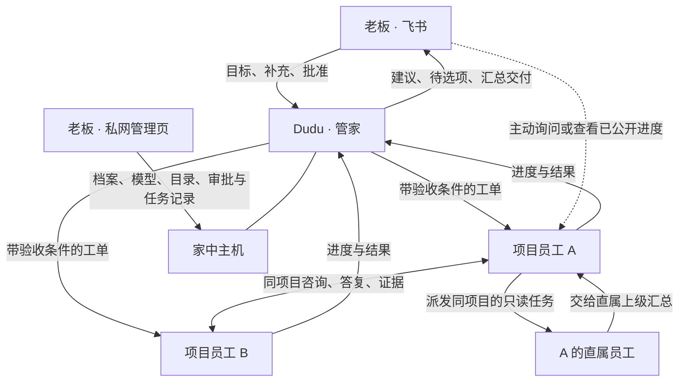

# Dudu OPC 需求核对

老板日常在飞书找管家 Dudu。Dudu 接单、派工、跟进和汇总。员工在项目内向同事请教，把结果交给 Dudu。家中主机保存角色资料、任务记录和项目文件，远端设备通过飞书或私网管理页使用同一套后台。

员工工作时由谁做决定，以及系统怎样处理实际的审批和重复派工，见[员工执行与审批](OPC_EXECUTION_ZH.md)。

## 逐项核对

| 需求 | 原先已有 | 本版处理 | 仍需现场验证或配置 |
| --- | --- | --- | --- |
| 底座与执行位置 | 原生 Suparagent 的团队、任务、审批、引擎和会话 | 保留上游 Git 历史和许可证，直接扩展原生代码。Windows 本机保存文件、执行工具，Codex 模型经网络推理 | 引擎能力各自不同，未单独接入 DSH |
| 老板、管家与员工 | 已有团队负责人和任务板 | Dudu 派工和收结果。员工在同一项目内咨询同事，受询员工只读选定任务背景；咨询全程留痕。老板主动向员工提问时，员工可在原私聊或授权群话题回答 | 群里只能查看已公开的进度、答复和交付。员工内部咨询原文保存在本机 |
| 大嘴给老板的回复 | 飞书、网页和配对手机可打开管家对话 | 大嘴称呼「老板」或「您」，有错说明自己哪里没办妥，需要您决定时再开口。完整回复在 1000 字以内直接显示，正好 1000 字也直接显示。超过 1000 字，飞书发送摘要和完整 Markdown，网页可下载原文，配对手机可保存或分享原文 | 文字、标点、换行和表情按 Unicode 码点计数。派工看回执，完成看核验结果 |
| 主动发现与决策 | 已有任务状态和审批 | Dudu 每两小时检查阻塞、逾期和待验收任务，重启后沿用上次检查时间。老板可要简报、让 Dudu 跟进、稍后处理或跳过。飞书每批最多发三条建议，两批之间至少相隔两小时 | 管家根据已有任务提出建议，老板批准后才生成跟进任务 |
| 员工招人和汇报 | 已有员工招募提案 | 老板可在大管家档案授权代审。直属员工执行项目任务时可以申请下属。大管家批准后，新员工使用独立目录，继承直属上级的模型，可接受上级派发的同项目只读任务。交付逐级汇总 | 大管家可以拒绝，也可以转请老板决定。老板在与大管家的对话里处理 |
| 两种协作方式 | 已有团队消息、房间和执行记录 | 派工、确认、咨询和汇报都保留文字。工单另存项目、负责人、目标、优先级、依赖、验收条件、交付物和事件。同事可分享标明来源的证据。派工与审批都校验当前岗位的授权 | 后台开放任务协议和执行记录给老板，飞书展示批准公开的部分 |
| 角色与任务上下文 | 已有角色目录、模型和任务范围 | 管家、员工各有自己的 `AGENTS.md` 和默认模型。资料可直接放入角色目录。先按角色、项目和功能寻找既有任务；明确续接沿用原会话，候选不清楚时确认。每次执行有独立记录，重复投递同一条消息只受理一次 | 不清楚时可直接回复任务编号。专业任务可用的文件和工具有明确范围 |
| 后台会话 | Codex 作为执行引擎 | 新的 GPT 员工执行使用临时引擎会话，后续工作从后台对话记录恢复。管理网页可从员工列表或派工记录打开同一会话 | 飞书员工身份绑定后，老板可在员工私聊发送「执行状态」「派工 #编号」查阅派工要求、答复与结果。已有桌面历史保留 |
| DeepSeek 管家指挥 GPT 员工 | Codex 已有团队工具和结构化派工 | 管家可独立选择 DeepSeek Flash 或 Pro，员工使用自己的模型。切换供应商后，复用对应模型的管家会话，向新会话提供工作编号和经办人。个人授权的 OpenAI 私聊摘要仍走独立的 GPT 入口 | 在本机用真实账号跑完一笔合成工单，未读取个人聊天或创建正式员工。[设置步骤](STEWARD_WINDOWS_ZH.md) |
| 建员卡与后台 | 原有建员提案、模型发现、工作目录和聊天设置 | 老板在「员工」里新建员工、审批招募方案、修改管家或员工的档案。档案可改名称、头像、职责、模型、工作目录、AGENTS.md 和汇报关系。「能力」里可进入技能、记忆、审批和飞书设置。团队卡显示成员摘要，并可打开对应档案 | 网页头像和飞书应用头像分别保存。飞书可提出用人需求，详细配置在后台完成 |
| 一次打开与日常聊天 | 原有本地启动脚本、飞书网关、消息队列 | 双击 `start-steward.cmd` 打开工作区。「对话」「员工」「项目」共用一个页面。档案中的「对话」可续接该员工最近的普通聊天，从会话进入档案后也能回到原会话。未发送草稿按工作区、员工和会话保存。会话标明实际模型，岗位、飞书或派工固定的模型会说明来源。飞书最终答复成功送达后撤回对应的「思考中」 | 无法确认是否发过的旧草稿可手动恢复。关机期间未送达本机的飞书事件能否补收，需在租户实测 |
| 员工身份与群 | Dudu 已有独立飞书应用 | 每人可绑定各自的飞书应用、老板身份和授权工作群。后台派工和状态可发到员工话题，老板也可在已绑定话题内 @ 员工 | 每个员工需要在飞书开放平台有真实应用，配置并加入群后才能显示相应姓名和头像。[飞书接入步骤](FEISHU.md) |
| 技能、MCP、工具和速度 | 复用 Codex、团队桥接和技能服务 | 验证原生 Codex 读取会话和工具服务就绪；覆盖团队工具调用、权限及技能使用记录。单独记录启动、受理、首次输出和结束。Windows 可让独立 Codex 进程使用现有本机代理 | 第三方 MCP 需自行配置授权。模型能否选用工具取决于所选引擎、会话和权限 |
| 多模态输入与输出 | 飞书已有附件存储和上传 | 测试用真实 PNG、DOCX、音频和 MP4 走本地输入链路。支持视觉的 Codex 可收到图片和最多三张带时间的视频抽帧。Windows 家庭主机用 Whisper Tiny 离线转写了 5.11 秒普通话，耗时 2.97 秒。说「读给我听」可用本机中文语音合成回复。图片、音视频及文件均可作为飞书交付 | 中文转写可能出现繁体和数字格式差异。已生成并解码实际的 Ogg Opus 语音，发送端使用模拟飞书接口。手机原生播放仍需真实租户验收 |
| 指定某个人的私聊 | 机器人可读取自己参与的会话 | 老板在「员工 → 所选岗位 → 能力 → 配置飞书能力」授权和登记联系人。每次查询都核对联系人、时间范围和经办员工，由管家私聊回复。可授权员工把选中片段交给 OpenAI Codex 分析。普通查看和检索在本机完成 | 飞书需批准用户身份权限，老板需完成个人授权并登记联系人。本地测试使用虚构会话 |
| 写进飞书云盘 | 原有飞书网关可发送交付文件 | 老板在后台粘贴目标文件夹链接，再让 Dudu 把正文或引用的上一条回答写成新文档。链接私聊返回，沿用文件夹原有分享权限 | 首次使用需个人飞书授权，对目标文件夹有新建权限。未替真实账号新建测试文档。[文档用法](FEISHU_DOCUMENTS_ZH.md) |
| 远程管理、重启与交付 | 本机回环地址、账号认证、持久化数据库 | Tailscale Serve 提供私网管理页。重启后双击桌面 Dudu，网页和飞书一起启动。关本机管理窗口时可选保留或停止后台服务 | 外部设备须加入同一私网并登录后台。远端关网页后，家中服务继续运行。[Windows 使用说明](STEWARD_WINDOWS_ZH.md) |

## 员工项目会话开发分支

| 事项 | 这版实现的行为 | 验收情况 |
| --- | --- | --- |
| 继续原任务 | 大嘴传递老板的原话、引用和附件。换人保留工单号，接手员工沿用自己的授权。前任已经发出的云端写入先核对，再决定是否继续 | 引用、迟到回执和重复写入有回归覆盖 |
| 员工后台 | 已登录的普通 Windows 账号可直接启动本地 Codex App Server。每名员工使用自己的会话目录，工单记录原生编号，项目根来自员工档案 | 本机用合成输入验证了建会话、关闭进程、重新启动和恢复同一编号，读回了先前输入。本次协议验收没有调用模型或项目终端 |
| 目录权限及工具 | 工作目录按档案设置，获准的同事目录只读。岗位技能、MCP、模型供应商和推理强度随任务传给引擎 | 项目终端、不同供应商的真实员工，以及必须本人确认的系统操作，需分别实机验收 |
| 二狗的文档 | 员工自己读获准的消息、提交分类和来源，再核对云端文档的标识、标题、正文和文件夹。单纯写文档可以独立于私聊授权 | 模拟接口覆盖删除、移走、重试和读回。真实租户的文件夹授权、最终链接和每周派工仍需现场验收 |
| 部署与旧记录 | 员工项目方式和每周知识库按配置启用。旧任务可继续从工作台查看 | 用本机备份的临时副本升级三版数据库结构，核对原有业务记录和数据库完整性后删除副本。正式岗位尚未切换 |

旧项目提供了本机托管 Codex 和按任务恢复会话的运行经验。这里沿用 Suparagent 的员工、飞书、审批和派工实现。[旧项目后台连接](https://github.com/lihan960222-sys/codex-super-agent/blob/dcef8292248395a65888f55d5a08a9781fc6c334/telegram-bridge/client.mjs) · [旧项目员工执行](https://github.com/lihan960222-sys/codex-super-agent/blob/dcef8292248395a65888f55d5a08a9781fc6c334/superagent/executor.mjs)

## 此前版本的验证

- 双模型版本的前端基础测试通过 464 项。浏览器测试覆盖建员卡、目录输入、编辑指令、审批、私聊授权范围和云盘文件夹。工作台和网页对话改版后，前端基础测试通过 474 项，文字对比度检查通过。
- 修复了从 `127.0.0.1` 打开工作台时出现的 `Failed to fetch`。同一台电脑上用三个全新的浏览器会话核对了 `127.0.0.1`、`localhost` 和 Tailscale 私网 HTTPS 入口。三者均从各自打开页面的地址读取登录状态并显示密码框。远端手机仍需登录同一私网后实测。
- 加入 DeepSeek 管家后，Windows 后端专项回归 229 项通过、1 项按运行条件跳过，报告中有 5 条警告。覆盖飞书输入输出、老板身份、角色与项目隔离、任务复用、团队协商、审批、建员、模型与技能。需要原生 Codex 的网关测试另行运行通过，覆盖员工完成后由管家在飞书原消息下只汇报一次。
- Windows 首轮后端全量运行得到 4,699 项通过、192 项跳过、99 项失败和 21 项错误。第一轮修复后重跑原有 120 个失败或错误用例，7 项通过，当时余下的 113 项均能在原生 Suparagent 上复现。Windows 的符号链接权限和仅适用 Unix 的测试占其中一部分。
- 双模型版本在 GitHub 的 Linux 环境通过了两组后端全量测试。SQLite 通过 5,133 项、跳过 56 项，PostgreSQL 17 通过 5,054 项、跳过 135 项。两组均有 6 条警告。测试覆盖员工咨询名单去重，以及飞书视频已送达后端、网关丢失回执时的重连和去重。[本次后台验收](https://github.com/lihan960222-sys/dudu-opc/actions/runs/45353369187)
- 同一台主机、同一模型的普通对话对比中，从受理到首次输出分别为 119.45 秒和 9.82 秒。指定联系人摘要另用虚构消息测试，直连和使用本机已配置的代理分别耗时 130.69 秒和 23.05 秒。各条件均为单次观测。
- 双模型现场验收约 22 秒。`deepseek-flash` 管家实际派工，`gpt-6.2-sol` 员工计算 37＋58 并从自己的岗位资料中取出随机验收词。管家收到员工回执后，准确复述了 95 和该验收词。工单已完成，三轮均有对应模型的用量记录。
- 飞书个人授权、联系人核对、员工经办与文档写入使用模拟账号和接口测试。真实模型测试只发送虚构文本。飞书账号授权、所选联系人、实际云盘目录和员工应用需在各自的租户配置。

## 参考

Suparagent 提供运行代码。旧项目用于理解老板和管家的使用习惯。Paperclip 的单一负责人、任务归属和审批，以及用户提供的 OPC 文档中有关组织、自然语言交互、结构化任务和项目协作的约定，作为本地改造依据。[Suparagent](https://github.com/Anil-matcha/suparagent) · [原项目](https://github.com/lihan960222-sys/codex-super-agent) · [Paperclip](https://github.com/paperclipai/paperclip/blob/master/docs/start/core-concepts.md)
