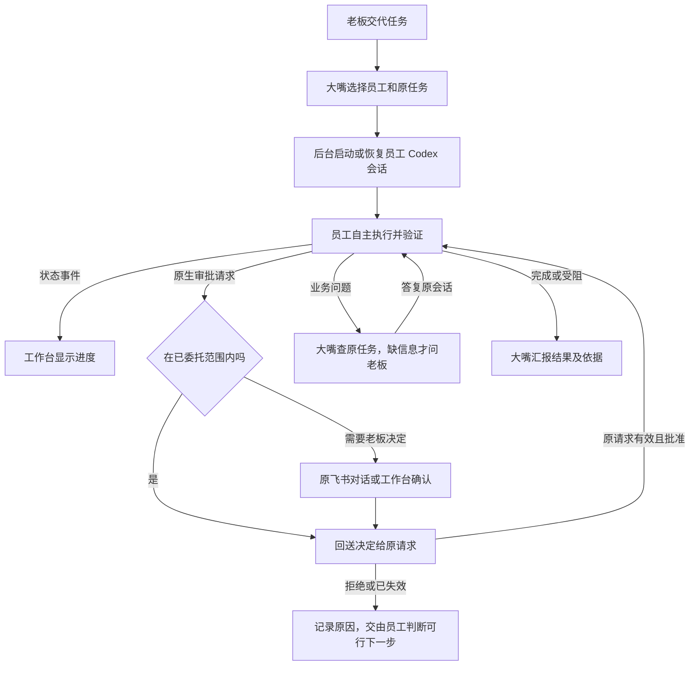

# 员工原生 Codex 执行与大嘴代批实施计划

> 下方清单保留原设计。实际交付和验证范围见本节，现场结果单独记录。

## 2026-11-27 实施记录

| 环节 | 已核对的结果 |
|---|---|
| 原生执行 | 家中主机安装的 Codex 在命令处等待，收到关联原请求的许可后启动了临时程序。独立检查读到了该程序写出的标记。 |
| 长期代批 | 同员工在同项目再次执行已确认的受支持命令，后台可以匹配原授权。目标文件内容、执行范围改变或授权撤销会打破匹配。工作台与飞书都可选仅本次；符合条件的请求才能记住。 |
| 本机启动器 | 用真实 Codex 检查了已安装的 Isaac Sim 启动程序。原生请求符合长期代批条件。该检查主动拒绝启动，不能据此判定应用或扩展已加载。 |
| 业务澄清 | 员工在原工单留下待答问题，大嘴取得答复后从该员工原会话续办。当前 CLI 默认关闭实验性原生提问窗口。 |
| 资料与网络 | 可分别指定外部只读资料目录和终端联网。Windows 实测关闭联网可阻断访问，直接联网允许向任何可达地址发送数据，未将域名过滤作为有效保障。 |
| 上线 | 工作台资源已重新构建。通过 HTTP 核对了 16 份在线页面和资源，四个机器人均已建立连接。 |

长期授权目前支持可准确识别的目录查询、指定进程查询和启动已安装程序。可改写的快捷方式采用单次审批；希望持续授权启动程序时，应使用实际安装路径。任意脚本、按用途区分公开查询与上传、永久拒绝和自定义有效期均未作为通用规则交付。

现场工单 33 由老板从飞书发起。Jensen 在同一回合收到并实际执行了两次「仅本次」放行的查询。其中一项使用的文件搜索程序未出现在员工终端环境中。第三项是多行目录查询，飞书网关接到决定后遇到后台冲突，申请在之后才到期。工单停止于启动之前，不能据此验收 Isaac Sim 或扩展加载。老板查询进度时，大嘴把待批查询错报成了启动命令。针对这些记录，网关在遇到冲突时回查原申请，管家查询工单时取得当前待批操作。无人登录和锁屏下的图形程序仍需现场验证。

**目标**　相同员工、项目目录、模型、工具和授权条件下，从飞书派工与直接在 Codex 项目里下达任务，应得到可比的执行能力。大嘴派工、接审批、收结果。员工自己选择做法、执行、检查产物。

**技术与依据**　沿用 Suparagent、Codex app-server、Windows、现有审批数据库、飞书网关和工作台。基础设计见 [员工项目运行环境](../specs/2026-11-26-employee-project-runtime-design.md)。本计划更新其中的运行权限与审批处理，以本轮确认的执行边界为准。

## 执行边界

| 谁 | 什么时候介入 | 职责 |
|---|---|---|
| 大嘴 | 开始、收到问题、结束 | 传递原要求、交付物和引用；找到负责员工及原任务；代批或询问老板；汇总员工核验过的结果。 |
| 员工与 Codex | 接单至交付 | 使用自己的模型、项目、会话、工具和连接，自主读写、联网、运行软件、调整方法、验证交付。二狗自己使用飞书授权。 |
| Dudu 后台 | 派工、状态事件、确切的审批或澄清请求、交付 | 保存任务与会话的对应关系，转送事件和决定。正常执行期间不逐条审命令、不因静默自动催办、不注入下一步指令。 |
| 老板 | 超出委托范围、业务选择、需要本人确认 | 在原飞书对话或工作台回复一次。Windows 安全桌面要求本人确认时单独提示。 |

## 权限取舍

- 以本机同版本 Codex 的项目设置为基准。新建后台会话时使用员工档案中实际的项目路径、引擎和模型。把员工会话存入独立后台配置目录，产物留在真实项目里。保留不同厂商的员工配置，本轮改造以 Codex 员工执行路径为范围。
- 本地目录、外部目录读取、员工间只读例外、网络分别配置。保留受保护路径和账号隔离。先记录现有权限，明确哪些会随迁移扩大。普通资料可按原生配置读取；其他员工的目录沿用岗位授权。目录外“只许新建”是可选扩展，若启用，须在实际创建时排他新建，重名即停。不得用目录写权限冒充仅新建。
- 联网区分查公开资料、下载、执行下载物、上传项目内容。按真实目标、目的与数据判断是否在老板的委托范围内。批准查资料不自动授权传出文件。
- 首次审批展示可复用范围，老板可选记住或仅本次。跨会话复用必须有明确授权，范围绑定员工、任务、资源、动作及有效期。改变路径、参数、目的地或上传内容时重新评估。业务聊天和员工回报都不能自行扩大委托范围。

## 等待、结束与续办

| 现场情况 | 此刻如何处理 | 答复如何生效 |
|---|---|---|
| Codex 的原生审批仍有效 | 将工单标为等待审批，保留原调用，向大嘴发送审批事件。 | 决定送回原请求，批准后继续执行；拒绝则让员工看到真实结果。 |
| 员工需要澄清业务问题 | 工单标为等待信息。原生提问仍在等待时就地答复；如果员工已通过消息提问并结束本轮，保存问题和已完成进度。 | 大嘴用已知信息回答，或代问老板；必要时在原工单、原会话开下一轮。 |
| 命令已失败、请求过期或进程已退出 | 保存最后已确认的步骤、失败原因、可能产生的副作用及继续所需条件，结束本轮。 | 收到新信息或授权后，先查实际状态，再在原工单、原会话补做缺失步骤。旧卡失效，条件未变时不自动重派。 |

## 老板设定委托

员工的执行权限决定可以申请或直接执行什么；老板的委托决定大嘴能代表谁批准哪些原生请求。工作台由老板管理，建议提供员工、项目、动作、目标资源、有效期五个条件。动作涵盖文件读取和写入、程序及命令、联网查询和下载、外发或上传、飞书文档操作。每条规则可选「大嘴可代批」「每次问我」「拒绝」。有效期可选本次、本任务、持续至撤销。老板可查看命中记录及撤销规则；下一次裁决前重新核对有效授权。未覆盖或含糊的请求转老板。大嘴可根据历史给出规则建议，须经老板确认后生效。工作台列出的示例默认不启用；复用范围须在首张审批卡上写清。

## 修改清单与执行顺序

### 0. 同样的审批只问一次

- [ ] 将老板本次明确的偏好落实为默认交互：大嘴第一次询问时写清「允许后，同员工在本项目做同一操作，我会代批」，并提供「允许并记住」「仅本次」「拒绝」。针对这张明确说明范围的卡片回复“允许”，按「允许并记住」处理。此前“审批默认仅本次”的约定仅适用于未展示复用范围的旧请求；不得批量转换旧回执。老板可明确要求以后固定拒绝同类请求。
- [ ] 复用已确认的规则时，核对老板、员工、项目、实际操作、资源、参数及权限级别。更换程序目标、增加上传内容或目的地、索取管理员权限等均重新判断。同一操作在新任务中仍匹配有效的项目级规则。撤销立即影响后续请求。
- [ ] 每次审批保留可追溯记录；相同规则在大嘴可跨会话检索的记忆中只保留一条摘要、规则标识和适用范围。实际放行以有效规则为准；审批过期、系统拒绝或一次性例外不生成长期授权。撤销时同步更新摘要。业务澄清也可复用明确且仍适用的答复，但其中的自然语言不会触发工具授权。
- [ ] 验收：第一次从飞书允许 Jensen 启动指定 Isaac Sim；重启服务、开启新任务后再次启动，大嘴代批，老板收不到第二次询问；换目标、撤销授权或当初明确点了「仅本次」时重新询问。

### 1. 先对齐真实项目与执行环境

- [ ] 在 `backend/tests/services/test_employee_runtime.py` 增加现状对照。记录同机原生 Codex 与后台员工的版本、工作目录、模型、可用终端、技能、MCP、外部目录、网络及桌面会话；只记录能力和状态，不输出凭据。先复现 Jensen 在后台受阻的差异。
- [ ] 修改 `backend/app/services/employee_runtime.py` 和 `backend/app/services/codex_adapter.py`。清点目前默认拒绝整盘、关闭网络、插件及其他运行参数的理由，分别映射到原生权限或员工明确配置。确保恢复会话时沿用正确身份；员工自己的飞书连接随会话可用。
- [ ] 在 `backend/app/services/thread_runtime.py` 核对工单、员工、项目、后台 thread 的关联。续办恢复同一会话，工作目录变更时显式处理。回归旧工单、同员工多任务、网页关闭后执行、个人 Codex 侧栏四种情况。

### 2. 接通 Codex 原生审批

- [ ] 在 `backend/tests/services/test_codex_adapter.py` 构造员工命令审批，先证明当前实现提前返回 decline。在 `backend/tests/services/test_local_approval_broker.py` 补两条并发请求、重复点击和过期回执用例。
- [ ] 修改适配器的 `_server_request` 和现有 `ApprovalBroker`。对接已部署 Codex 支持的命令、文件变更及权限请求类型；逐类验证回复格式。把请求关联到员工、任务、会话、轮次、连接代次和原始请求编号。复用现有审批机制；未知类型保守处理并给出具体原因。
- [ ] 由后台核对大嘴被授予的权限，再把允许或拒绝通过原连接回给 Codex。只释放这一次等待。将“决定已送达”和“命令已执行”分别记录，收到实际工具结果才报告成功。超时、取消、断线和服务重启时使旧请求失效；重连先检查执行结果，避免重复启动或写入。

### 3. 飞书和工作台共用一个审批结果

- [ ] 在 `backend/app/feishu/approvals.py` 复用现有通知、答复入口；工作台复用 `frontend/components/approvals/ApprovalsPanel.tsx`。卡片显示员工、任务、目标、动作、申请原因和有效状态。能取得真实截止时间才显示倒计时。
- [ ] 老板点卡片或引用卡片回复“允许”都绑定原请求。无引用时，只有身份、会话和唯一待批项都能确定才接受。飞书和网页同时操作，首个有效决定生效，另一端同步显示。区分老板决定、大嘴代批、系统拒绝和请求过期。
- [ ] 区分业务提问和工具审批。“整理多久”从任务原话找答案；“能否执行这条命令”走审批协议。Windows UAC 单列为需要本机确认。回归 `backend/tests/feishu/test_approval_dm.py` 和 `backend/tests/routers/test_approvals_api.py`。

### 4. 保留可见性，退出日常执行

- [ ] 在 `backend/app/services/thread_runtime.py` 对照现有事件区分执行中、等待审批、等待信息、已完成、受阻。正常工具调用只更新状态。查询进度、重复收到飞书事件、送达回执失败均不得触发重新派工。
- [ ] 增加 `backend/tests/services/test_thread_runtime.py` 用例。员工在原会话验证产物；相同阻塞再次出现且没有新条件时如实汇报。员工完成后飞书发送失败，只补发汇报。测试中统计工单、真实执行、投递次数三组数字。

## 验收与上线

每项先跑对应回归并确认能复现旧问题，再改代码、跑绿、单独提交。以下真实试点需同时记录任务号、后台会话、请求编号（如有）、真实结果；模拟通过和现场通过分列。

| 实测输入或条件 | 通过标准 |
|---|---|
| “让 Jensen 启动 Isaac Sim，确认扩展加载了没有” | 在实际登录桌面启动，找到对应进程；从本次 Kit 日志或应用状态核对扩展。区分启动、加载、失败。 |
| 已委托给大嘴的命令；另一个需要老板决定的命令 | 两条原生请求分别得到正确决定。飞书批准后原调用继续，拒绝后无副作用。 |
| 同时两条待批、重复点卡、审批期间重启 | 决定不串单，不重复执行，过期卡如实显示。 |
| 老板只批本次启动、随后撤销另一条长期授权 | 后续请求重新匹配当前规则；大嘴不能依据历史同意代批。 |
| 员工已结束本轮后收到澄清，或已创建产物后请求过期 | 在原工单、原会话续办；读回已完成的产物，不重复创建。 |
| “查公开资料”随后要求上传一份项目文件 | 查询能访问目标；上传服从独立的数据与目的地授权，最终状态可核对。 |
| “让二狗读 Jensen 的目录并整理为飞书文档” | 读取真实项目，跨员工写入受到约束，二狗以自己的连接创建并读回文档。 |
| “继续刚才那单”，随后关闭工作台 | 原会话继续，网页关闭不影响后台；飞书收最终回执，桌面 Codex 侧栏没有新增员工会话。 |

上线前记录当前版本和员工设置，先用 Jensen 试点，再测二狗的飞书与跨目录例外，最后切换其他 Codex 员工。切换时核对在途任务与待批项；回滚恢复上一版员工配置，保留任务、产物和审批记录，避免重复执行。桌面启动还取决于 Windows 登录会话，分别记录已登录、锁屏、无人登录的实测结果。
